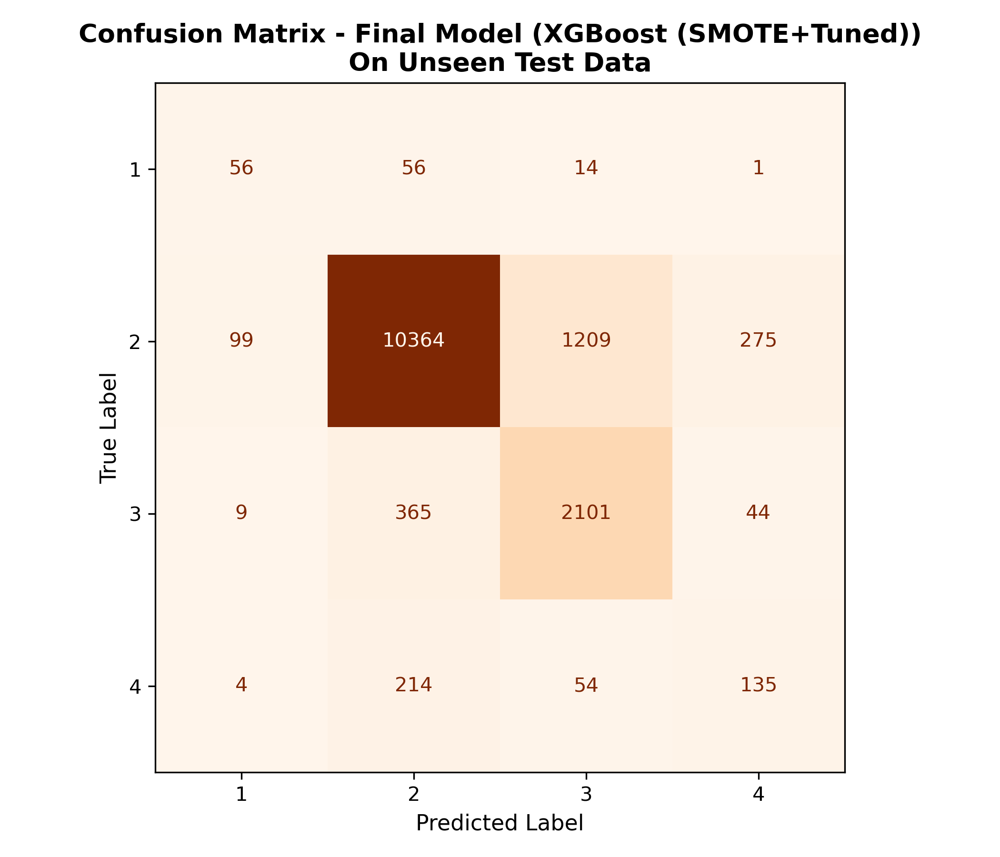

# Traffic Severity Prediction

Predicting the severity of road traffic incidents (4 classes) from tabular and text features,
with a full data-mining pipeline: cleaning, feature engineering, feature selection, class-imbalance handling,
and a comparison of three models.

Course project for **Data Mining**, Faculty of Computer Science, University of Tehran (Spring 2026, Group 32).

## Overview

Each row of the dataset is a crowdsourced traffic-incident report with coordinates, timestamps, weather,
and a free-text description. The target `y` is the incident severity (class 1 to 4). The task is
**multi-class classification** on a strongly imbalanced dataset.

Main challenges:
- Heterogeneous data (text, numbers, coordinates, booleans)
- Missing values (up to 44% in one column), without dropping rows
- Severe class imbalance (class 2: ~80% of samples, class 1: <1%), so accuracy alone is misleading
- Constraint: at most 25 features in the final models

## Dataset

| | |
|---|---|
| Samples | 100,000 |
| Raw features | 34 (`f1`-`f34`, anonymised) |
| Target | `y`, 4 classes (1 = most severe, 2 = normal) |
| Split | 70% train / 15% validation / 15% test (stratified) |

Class distribution: class 1 = 0.85%, class 2 = 79.65%, class 3 = 16.79%, class 4 = 2.71%.
The data is not redistributed here; see [`data/README.md`](data/README.md).

## Method

1. **Split first** (stratified, before any preprocessing) to avoid data leakage.
2. **Preprocessing pipeline** (custom scikit-learn transformers in `notebooks/custom_transformers.py`):
   - duplicate removal on the training set
   - Regex-based features from the text fields (highway, severe crash, slow traffic, ...) instead of TF-IDF
   - time features: duration in minutes, start hour, month, weekday (cyclic encoding)
   - median/mean imputation, IQR capping of outliers (factor 1.5)
   - Robust/Standard/MinMax scaling, Target Encoding for high-cardinality categories (city, state)
3. **Feature selection**: constant columns and a column with >40% missing values removed, then a combined
   rank of Mutual Information, ANOVA F-score and Extra Trees importance; the top **25** features were kept.
4. **Imbalance handling**: SMOTE with several sampling strategies, plus decision-threshold tuning for Logistic Regression.
5. **Models**: Decision Tree (simple), XGBoost (complex), Logistic Regression (linear baseline).
   Hyperparameters and SMOTE strategy were chosen by Macro F1 on the validation set
   (972 combinations for XGBoost).

## Results (test set, 15,000 samples)

| Model | Accuracy | Macro F1 | Weighted F1 | Inference time (s) |
|---|---|---|---|---|
| Logistic Regression (tuned threshold) | 0.772 | 0.478 | 0.801 | 0.021 |
| Decision Tree (SMOTE + tuned) | 0.808 | 0.491 | 0.816 | 0.014 |
| **XGBoost (SMOTE + tuned)** | **0.844** | **0.577** | **0.851** | 0.206 |

**XGBoost** was chosen as the final model: its Macro F1 is about 9-10 points higher than the other two,
which matters most for the rare, critical classes.

Final model, per class:

| Class | Precision | Recall | F1 | Support |
|---|---|---|---|---|
| 1 | 0.33 | 0.44 | 0.38 | 127 |
| 2 | 0.94 | 0.87 | 0.90 | 11,947 |
| 3 | 0.62 | 0.83 | 0.71 | 2,519 |
| 4 | 0.30 | 0.33 | 0.31 | 407 |



Feature selection (35 candidate features -> 25), measured with a Random Forest baseline:

| Feature set | Features | Accuracy | Macro F1 |
|---|---|---|---|
| All candidates | 35 | 0.821 | 0.521 |
| Selected | 25 | 0.824 | 0.527 |

Using 25 features did not hurt performance. The weak spots are classes 1 and 4 (very few samples, and
the text of the report is often the only signal).

The full write-up is in [`docs/Project_Report_EN.md`](docs/Project_Report_EN.md).

## Repository structure

```
notebooks/   EDA, Preprocess, Feature_Selection, the three models, Final Evaluation, helper .py files
outputs/     feature-selection tables and the final confusion matrix
models/      list of the 25 selected features (trained .pkl files are not tracked)
docs/        English project report
data/        instructions for obtaining the data (data itself is not included)
```

## How to run

```bash
git clone https://github.com/YeganehGhaderi/traffic-severity-prediction.git
cd traffic-severity-prediction
pip install -r requirements.txt
# put the course dataset in data/raw/group_32_train.csv (see data/README.md)
jupyter notebook
```

Run the notebooks in this order: `EDA` -> `Preprocess` -> `Feature_Selection` -> the three model notebooks
-> `Final Evaluation`. The notebooks already contain their saved outputs, so you can read the results without running anything.

## Tech stack

Python, pandas, NumPy, scikit-learn, imbalanced-learn (SMOTE), XGBoost, matplotlib, seaborn

## Team

- **Yeganeh Ghaderi**: preprocessing pipeline, Decision Tree and XGBoost models, final evaluation, final report
- **Arvin Bahrami**: data exploration, EDA, feature selection, Logistic Regression model

All stages were debugged and discussed together.

## Future work

- Replace Regex features with word embeddings / language models for the report text
- Add road-network and spatial features (e.g. graph neural networks)
- Explain predictions with SHAP
- Model the problem as multi-label classification

## License

MIT
